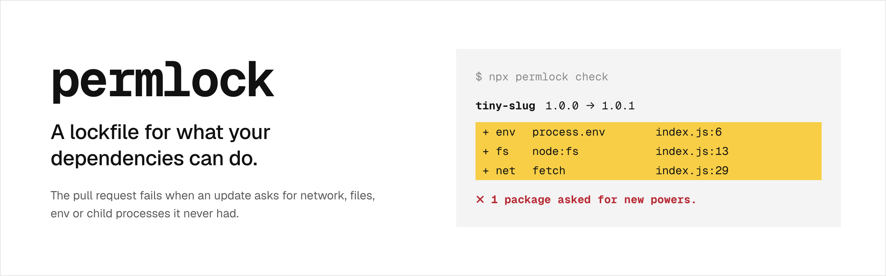

<p align="center">
  <picture>
    <source media="(prefers-color-scheme: dark)" srcset="assets/banner-dark.png">
    
  </picture>
</p>

<p align="center">
  <a href="https://www.npmjs.com/package/permlock"></a>
  <a href="https://github.com/alii13/permlock/actions/workflows/ci.yml"></a>
</p>

permlock is a capability check for npm dependencies. It reads every package in `node_modules` without running it, records what each one can touch in `permlock.json`, and fails the pull request when an update asks for a power it never had.

Here is a patch release of a small slug helper that quietly started reading your environment, your files and the network:

```
$ npx permlock check

  tiny-slug  1.0.0 → 1.0.1    3 escalations

    + env     process.env          index.js:6
    + fs      node:fs              index.js:13
    + net     fetch                index.js:29

✗ 1 package asked for new powers.
```

- `tiny-slug  1.0.0 → 1.0.1` is the package and the update that changed it.
- Each `+` line is a power the old version did not have, the code that gives it away, and the first line that uses it.
- The exit code is 1, so CI goes red. When nothing new shows up, you get one green line and exit code 0.

This is a real run against a test fixture in this repo, not a mockup.

## Try it

Run this in any project that has `node_modules` installed:

```
npx permlock init
```

It writes `permlock.json` and tells you what your tree can do today. This is a 19-package API built with Hono, Drizzle and Zod:

```
  19 packages locked

  touch the network          3   @hono/node-server, @recall/shared>postgres, youtube-transcript
  touch files                1   @recall/shared>postgres
  read env                   2   @recall/shared, @recall/shared>postgres
  evaluate code              1   zod
  touch the system           1   @recall/shared>postgres
  need nothing              14
```

Commit `permlock.json` next to your package lockfile. From then on, `permlock check` compares the installed tree with it.

## Use it in CI

```yaml
name: permlock
on: pull_request

permissions:
  contents: read

jobs:
  permlock:
    runs-on: ubuntu-latest
    steps:
      - uses: actions/checkout@v7
      - uses: actions/setup-node@v7
        with:
          node-version: 24
      - run: npm ci --ignore-scripts
      - uses: alii13/permlock@v0
```

The action needs no token and no account. It reads the installed tree, compares it with the committed `permlock.json`, prints the result to the job summary, and fails the job on a new power. Any other CI can run `npx permlock check` and read the exit code:

| Exit code | Meaning |
| --- | --- |
| 0 | No package asked for anything new |
| 1 | At least one package asked for a new power |
| 2 | permlock could not run, for example no `package.json` |

When a new power is expected, review the code it points at, then record it:

```
npx permlock accept tiny-slug
```

Commit the updated `permlock.json` with a sentence in the pull request saying why. The diff is the review.

## What permlock.json records

```json
{
  "schema": "permlock/v0",
  "profile": "node",
  "packages": {
    "tiny-slug": {
      "version": "1.0.1",
      "observed": {
        "env": [{ "file": "index.js", "line": 6, "via": "process.env" }],
        "fs": [{ "file": "index.js", "line": 13, "via": "node:fs" }],
        "net": [{ "file": "index.js", "line": 29, "via": "fetch" }]
      },
      "declared": null
    }
  }
}
```

- Each key is a package's canonical name: the shortest dependency path to it, joined with `>`. These are the names LavaMoat uses.
- `observed` has one list per capability. Each item is the first place that capability shows up: the file, the line, and what matched.
- `declared` is the package's own `capabilities` field from its package.json, or `null` if it has none.
- Packages that need nothing are listed too, with `"observed": {}`.

The format is an open spec, not a permlock detail: [spec/SPEC.md](spec/SPEC.md), with a [JSON Schema](spec/permlock.schema.json) and [conformance cases](spec/conformance) any other tool can test against.

## The nine capabilities

| Capability | Means | Matched by |
| --- | --- | --- |
| `net` | talks to the network | `net`, `tls`, `http`, `https`, `http2`, `dns`, `dgram`, `fetch`, `WebSocket`, `XMLHttpRequest`, `EventSource`, `navigator.sendBeacon` |
| `fs` | reads or writes files | `fs`, `fs/promises` |
| `env` | reads environment variables | `process.env` |
| `exec` | starts other programs | `child_process` |
| `eval` | runs code built at runtime | `vm`, `eval`, `Function`, `WebAssembly` |
| `worker` | starts threads or processes | `worker_threads`, `cluster`, `Worker` |
| `native` | loads compiled code | a loaded `.node` file, a `binding.gyp`, `process.dlopen` |
| `system` | changes the process or machine | `os`, `inspector`, `v8`, `process.kill`, `process.exit`, `process.chdir` |
| `install` | runs code at install time | `preinstall`, `install` and `postinstall` scripts |

Builtins match with or without the `node:` prefix, and globals match any path below them, so `process.env.HOME` is `env`. Everything else, like `console`, `URL` or `crypto.randomUUID`, counts as pure and is not recorded. The list lives in [spec/capabilities.json](spec/capabilities.json).

## For package maintainers

```
npx permlock declare
```

This writes a `capabilities` field into your package.json from what your own code does, plus a `permlock-badge.json` for [shields.io](https://shields.io/badges/endpoint-badge). It prints the badge line for your README, which reads like this:


Keep it true in CI:

```yaml
      - uses: alii13/permlock@v0
        with:
          mode: verify
```

`verify` fails a pull request that makes your package need more than it declares. Apps that depend on you see the same thing: if your code ever does something your declaration leaves out, their `permlock check` fails too. permlock's own npm package declares `exec`, because it starts the binary.

## How it works

permlock never runs package code. It starts at your package.json and walks `node_modules` the way Node resolves imports, so any install that produces a `node_modules` folder should work. The tests cover npm and pnpm layouts. It follows only the modules reachable from your entry points, parses each one with [oxc](https://oxc.rs), and turns every free identifier and builtin import into a path like `process.env.HOME` or `node:fs`. The vocabulary above maps those paths to nine classes. The output is sorted JSON, so the diff in a pull request shows the change in powers and nothing else.

## LavaMoat compatibility

[LavaMoat](https://github.com/LavaMoat/LavaMoat) enforces per-package permissions at runtime. `permlock generate --lavamoat` also writes `lavamoat/node/policy.json`, and on the one real app tested so far it is byte-identical to the policy LavaMoat 2.0.1 writes: same package names, same keys, same `policy-override.json` merge, same order. Check it on your own project:

```
npx lavamoat generate dist/index.js
cp lavamoat/node/policy.json /tmp/lavamoat-policy.json
npx permlock generate --lavamoat --entry dist/index.js
cmp lavamoat/node/policy.json /tmp/lavamoat-policy.json && echo identical
```

To get there, permlock reproduces LavaMoat's analysis rules on purpose, quirks included. `permlock.json` uses its own rules and sees a little more. A dynamic `import("node:fs")` is in `permlock.json`, for example, but not in LavaMoat's policy.

## Speed

Generating the LavaMoat policy for the 19-package API above:

| Tool | Five runs |
| --- | --- |
| LavaMoat 2.0.1, `lavamoat generate` | 3.12 s, 3.13 s, 2.64 s, 2.68 s, 2.82 s |
| permlock 0.1.0, `permlock generate --lavamoat` | 0.07 s, 0.04 s, 0.04 s, 0.04 s, 0.04 s |

Apple M3 Pro, Node 26.12, timed with `/usr/bin/time`. Both wrote the same file. One project is not a benchmark suite; run [scripts/bench.sh](scripts/bench.sh) on yours and open an issue with the numbers, especially if permlock loses.

## What it can't see

permlock reads code; it does not run it. Here is each blind spot and what permlock does about it today:

- **Imports of a computed string,** like `require(name)`. The target is not followed, so its code is not read. Nothing is reported yet.
- **Powers reached through an alias,** like `const p = process; p.env.TOKEN`. This is recorded as plain `process`, which maps to no capability. Missed today.
- **Computed lookups on the global object,** like `globalThis["fe" + "tch"]`. Missed today.
- **`eval` and `new Function`.** Reported as `eval`. The code they build is not analyzed.
- **Native addons.** Reported as `native` when a `.node` file is loaded or a `binding.gyp` is present. What the compiled code does is opaque.
- **Install scripts.** Reported as `install`, never blocked. Use `npm ci --ignore-scripts` or pnpm's build allowlist to stop them.
- **Bundled code.** A bundle has no package boundaries, so permlock reads `node_modules`, not your build output.
- **Yarn Plug'n'Play** installs have no `node_modules` folder and are not supported.

If you find a way past permlock that is not on this list, please [report it privately](SECURITY.md).

## When not to use permlock

- You want packages stopped at runtime. Use LavaMoat; permlock only reports.
- You want known vulnerabilities. Use `npm audit` or [OSV-Scanner](https://github.com/google/osv-scanner); permlock knows nothing about CVEs.
- You want install scripts blocked. Use `--ignore-scripts` or your package manager's build allowlist.

## Status

This is the first release.

- The `permlock.json` format is a v0 draft. It may change before 1.0, which comes when a second implementation passes the conformance cases.
- CI runs the tests on macOS and Linux. Windows binaries are built for every release, but the test suite does not run on Windows yet.
- LavaMoat parity is proven on one real app. The goal is twenty.
- **Is it ready for production?** Use it as a CI check that tells a person to look. It is one signal, not your only defense.

A false alarm is a bug. Open an issue with the package name and version, its entry from `permlock.json`, and the file and line it points at.

## Install

`npx permlock` covers most uses. To pin a version in your lockfile, or to skip npm:

```
npm install --save-dev permlock
cargo install permlock
```

Every [GitHub release](https://github.com/alii13/permlock/releases) has binaries for macOS, Linux and Windows, with `SHA256SUMS` and build provenance you can check:

```
gh attestation verify permlock-linux-x64 --repo alii13/permlock
```

The macOS binaries are signed but not notarized. `npx`, `npm install` and `cargo install` are not affected. If you download a binary with a browser, clear the quarantine flag once before running it:

```
xattr -d com.apple.quarantine permlock-darwin-arm64
```

## Commands

| Command | Does |
| --- | --- |
| `permlock init [dir]` | Write `permlock.json` and print what the tree can do |
| `permlock check [dir]` | Fail when a package asks for more than `permlock.json` allows |
| `permlock accept <package> [dir]` | Record a package's new powers after you review them |
| `permlock generate [dir]` | Rewrite `permlock.json` from scratch |
| `permlock declare [dir]` | Write your package's own capabilities and badge |
| `permlock verify [dir]` | Fail when your package needs more than it declares |
| `permlock check --base a.json --head b.json` | Compare two lock files |

Options: `--out <dir>` for where `permlock.json` lives, `--entry <file>` to analyze from one file, `--dev` to include the root's devDependencies, and `--lavamoat` to also write the LavaMoat policy.

## Acknowledgements

- [oxc](https://github.com/oxc-project/oxc) parses every file and resolves every scope. permlock is a thin layer on its semantic analysis.
- [LavaMoat](https://github.com/LavaMoat/LavaMoat) and [Endo](https://github.com/endojs/endo) define the policy format, the package naming and the analysis rules permlock reproduces. The byte-identical policy exists so that permlock adds to their ecosystem instead of splitting it.
- [Capslock](https://github.com/google/capslock) showed capability analysis for Go. permlock's class names follow its names where the meanings match.

## License

MIT or Apache-2.0, at your option.
